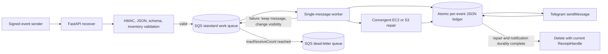

# Fénix: autorreparación local de infraestructura

Fénix recibe eventos de infraestructura autenticados, los valida frente a un inventario propiedad del grupo, repara un recurso autorizado de LocalStack, registra el progreso y envía una notificación por Telegram. Es un laboratorio académico, no un controlador de nube de producción ni un sistema con garantía de procesamiento exactamente una vez.

## Responsabilidades del equipo y del curso

El equipo docente aprobó una excepción para equipos de dos personas. Esto no exime de ningún requisito de roles, evidencias, revisión o defensa. Los nombres y correos electrónicos de integrantes, así como las asignaciones de responsables, siguen pendientes; la excepción no definió cómo se distribuyen los seis roles.

| Integrante del equipo | Correo electrónico | Estado |
|---|---|---|
| `[Pending: nombre del integrante 1]` | `[Pending: correo del integrante 1]` | Sin asignar en este repositorio |
| `[Pending: nombre del integrante 2]` | `[Pending: correo del integrante 2]` | Sin asignar en este repositorio |

| Rol obligatorio del curso | Enfoque del módulo y resumen de evidencias | Persona responsable |
|---|---|---|
| I1 Entradas y Excepciones | `receiver.py`, `events.py`, validación y gestión de firmas; rechazo de entradas firmadas y evidencia de errores HTTP (F04–F07, F13). | `[Pending: asignación]` |
| I2 Mensajería e Inventario Cloud | `sqs.py`, `demo.py` y configuración; comportamiento de la cola/DLQ, inventario propiedad del grupo y evidencias de conciliación (F01, F08, F10). | `[Pending: asignación]` |
| I3 Webhooks y Reparación | Aceptación de webhooks y remediación verificada de EC2/S3 en `receiver.py` y `remediation.py` (F02–F07). | `[Pending: asignación]` |
| I4 Observabilidad y Comunicación | Evidencias de entrega y reintentos de Telegram, y registros rotativos con datos redactados en `notifications.py` y `logging_json.py` (F02, F14, F16). | `[Pending: asignación]` |
| I5 Integración y Worker | Procesamiento durable, reintentos mediante cambios del tiempo de visibilidad en SQS, recuperación y confirmación en `worker.py`, `state.py` y `sqs.py` (F08–F12). | `[Pending: asignación]` |
| I6 Pruebas y Diagnóstico | Informes de pruebas y evidencias de diagnóstico vinculados con la matriz de verificación (F01–F16), diferenciando los resultados sin conexión de las integraciones pendientes. | `[Pending: asignación]` |

## Requisitos previos

- Python 3.12.3 es la versión objetivo seleccionada por el equipo del proyecto y está verificada en el entorno `.venv` de esta copia. La segunda persona del equipo también debe usar Python 3.12.3; su entorno todavía no se verificó. `pyproject.toml` mantiene `requires-python = ">=3.11"` porque el curso permite versiones más recientes y los metadatos conservan una versión mínima de compatibilidad, en lugar de fijar la versión objetivo del equipo.
- Docker Desktop con su motor WSL2, Docker Compose y la imagen y configuración de autorización de LocalStack aprobadas para el curso.
- Un bot y un chat de Telegram configurados por el equipo fuera del control de versiones. Nunca pegues credenciales en incidencias, chats, capturas de pantalla ni en este README.
- La guía aprobada del curso y las reglas para nombrar recursos.

`requirements.txt` declara las dependencias directas; `requirements-lock.txt` registra las versiones de paquetes instaladas en el entorno `.venv` verificado con Python 3.12.3, incluida una referencia portable al proyecto editable (`-e .`). El archivo de bloqueo no usa una ruta específica de una máquina. Ambas personas del equipo deben usar la versión seleccionada de Python; confirma el intérprete de la segunda persona antes de considerar alineados los entornos del equipo. No uses una imagen de LocalStack no aprobada ni copies un token de autorización de ejemplo en un artefacto compartido. El cliente del SDK de AWS rechaza los endpoints que no sean el puerto de loopback 4566 y requiere credenciales ficticias de LocalStack proporcionadas mediante el entorno.

## Instalación desde una copia limpia

1. Crea y activa un entorno virtual:

   ```bash
   python3.12 -m venv .venv
   source .venv/bin/activate
   python --version  # Must report Python 3.12.3
   python -m pip install -r requirements-lock.txt
   ```

2. Crea el archivo local de entorno, que está ignorado por el control de versiones, e introduce solo la configuración local aprobada para el curso:

   ```bash
   cp .env.example .env
   ```

    Los nombres de variables obligatorios o admitidos son `AWS_ENDPOINT_URL`, `AWS_DEFAULT_REGION`, `AWS_ACCESS_KEY_ID`, `AWS_SECRET_ACCESS_KEY`, `GROUP_ID`, `QUEUE_PREFIX`, `WEBHOOK_SECRET`, `NOTIFY_PROVIDER`, `TELEGRAM_BOT_TOKEN`, `TELEGRAM_CHAT_ID`, `LOCALSTACK_IMAGE` y `LOCALSTACK_AUTH_TOKEN`. Define tanto `AWS_ACCESS_KEY_ID` como `AWS_SECRET_ACCESS_KEY` exactamente en `test`; se rechazan otros valores. Nunca uses credenciales reales de AWS; el cliente proporciona explícitamente estos valores a Boto3 y no usa perfiles ni cadenas de credenciales de AWS. Aquí no se documenta ningún valor.

3. Después de confirmar la imagen y el token aprobados para el curso, inicia el emulador local:

   ```bash
   docker compose up -d localstack
   ```

4. Inicializa las colas y los recursos de demostración etiquetados del grupo:

   ```bash
   python -m fenix.cli init-queues
   python -m fenix.cli setup-demo
   ```

5. Inicia el receptor y el worker en terminales separados:

   ```bash
   uvicorn fenix.services.receiver:app --host 127.0.0.1 --port 8000
   python -m fenix.cli worker
   ```

Estos comandos describen el flujo de configuración manual. La ejecución más reciente de integración con pytest y activación explícita sí llamó al endpoint local aprobado de LocalStack; los comandos de configuración anteriores no constituyen evidencia de esa ejecución. No se realizaron llamadas a AWS. La evidencia redactada de un envío real a Telegram está en `evidencias/telegram/2026-11-21T060138Z_a9b1da_F02_telegram-evidence.json`.

## Flujo de eventos



## Contrato del webhook

El receptor acepta `POST /webhook` con el formato exacto de encabezado que aparece a continuación. La firma es HMAC-SHA256 sobre los bytes ASCII de la marca de tiempo, un punto y los bytes originales del cuerpo. La marca de tiempo debe estar dentro de un intervalo de 300 segundos. Los encabezados de firma duplicados o ambiguos se rechazan antes de analizar el JSON.

```text
X-Webhook-Signature: t=<epoch>,v1=<64 hexadecimal characters>
```

El cuerpo está limitado a 16 KiB y debe ser un objeto JSON cerrado con exactamente estos campos:

```json
{
  "schema_version": 1,
  "event_id": "evt-node-001",
  "event_type": "instance.stopped",
  "resource_id": "node-01",
  "occurred_at": "2026-10-22T18:00:00Z",
  "simulate_failures": 0
}
```

`event_id` y `resource_id` deben coincidir con `[a-z0-9-]{3,32}`. Los únicos tipos de evento son `instance.stopped` para `node-01` y `bucket.tags_missing` para `bucket-01`. `simulate_failures` es un entero entre 0 y 5; los valores booleanos no son válidos. Las marcas de tiempo deben indicar explícitamente UTC (`Z` o `+00:00`). La solicitud no puede incluir identificadores de recursos ni destinos de nube.

| Estado HTTP | Significado |
|---|---|
| `202` | SQS confirmó el envío; el cuerpo contiene `status`, `event_id` y `message_id`. |
| `400` | El cuerpo firmado no es UTF-8 o JSON válido. |
| `401` | La firma falta, está mal formada, duplicada, no es válida o está fuera de la ventana de tiempo. |
| `413` | El cuerpo supera los 16 KiB. |
| `422` | El JSON es válido, pero incumple el contrato del evento o del inventario. |
| `503` | El inventario o SQS no están disponibles; el receptor no afirma haber aceptado el evento. |

## Inventario de recursos

`data/inventory.json` usa como claves los alias de evento. Cada recurso guarda su identificador de nube bajo la única clave canónica `id`; los eventos del webhook siguen incluyendo únicamente `node-01` o `bucket-01` en `resource_id`.

El inventario siguiente es solo un ejemplo sintético de documentación. Sus alias,
valores de grupo y etiquetas e identificadores de nube son ilustrativos; no son
valores reales de cuentas ni de recursos.

```json
{
  "node-01": {
    "type": "ec2",
    "group_id": "grupo-01",
    "id": "i-0123456789abcdef0",
    "security_group_id": "sg-0123456789abcdef0",
    "expected_tags": {
      "ManagedBy": "ppa2",
      "Project": "fenix",
      "GroupId": "grupo-01",
      "Owner": "grupo-01",
      "Name": "fenix-grupo-01-node"
    },
    "status": "ready"
  },
  "bucket-01": {
    "type": "s3",
    "group_id": "grupo-01",
    "id": "fenix-grupo-01-demo",
    "expected_tags": {
      "ManagedBy": "ppa2",
      "Project": "fenix",
      "GroupId": "grupo-01",
      "Owner": "grupo-01"
    },
    "status": "ready"
  }
}
```

El comando de configuración también puede guardar metadatos de aprovisionamiento como `group_id`, `status`, `image_id` y `client_token` de EC2, y `security_group_expected_tags`. El receptor resuelve el alias mediante este inventario y no acepta un identificador de nube en el webhook.

## Escritor único y recuperación de LocalStack

Ejecuta un solo proceso que escriba en un directorio `data/` determinado. Los archivos de estado se reemplazan de forma atómica, pero el proyecto no proporciona bloqueo entre procesos ni transacciones. Detén el worker antes de ejecutar una operación de CLI o hacer una edición manual que modifique un manifiesto. Nunca elimines `data/` mientras sigan existiendo recursos propiedad del inventario; el inventario es el registro de pertenencia necesario para una conciliación segura.

Después de un reinicio aprobado de LocalStack, considera obsoletos todos los ID de nube guardados previamente:

1. Detén el worker de Fénix y cualquier otro proceso que pueda escribir en `data/`. Conserva `data/` intacto.
2. Reinicia únicamente el entorno de LocalStack aprobado para el curso, siguiendo el procedimiento establecido. No uses credenciales reales de AWS ni elimines el inventario de Fénix como atajo para reiniciar.
3. Concilia con `python -m fenix.cli setup-demo`. La configuración vuelve a consultar el grupo de seguridad y la instancia mediante las etiquetas de pertenencia del grupo y, cuando está disponible, el `ClientToken` anterior de EC2 (incluido el token heredado estable); no usa un ID guardado de instancia o grupo de seguridad como prueba de pertenencia. Si la imagen mock anterior ya no está disponible, la configuración selecciona una imagen mock disponible y no reutiliza un token de idempotencia con parámetros de lanzamiento distintos. La imagen y el token seleccionados se guardan antes del lanzamiento, y el ID canónico devuelto para la instancia se guarda antes de la llamada posterior de verificación. Los recursos existentes solo se adoptan después de verificar sus etiquetas de pertenencia.
4. Verifica con Boto3 el inventario conciliado antes de iniciar el worker:

   ```bash
   python - <<'PY'
   from fenix.config.settings import client
   from fenix.utils.state import load

   inventory = load("data/inventory.json")
   node = inventory["node-01"]
   bucket = inventory["bucket-01"]
   assert node["status"] == bucket["status"] == "ready"

   ec2 = client("ec2")
   response = ec2.describe_instances(InstanceIds=[node["id"]])
   instances = [
       instance
       for reservation in response.get("Reservations", [])
       for instance in reservation.get("Instances", [])
   ]
   assert len(instances) == 1 and instances[0]["InstanceId"] == node["id"]
   instance_tags = {tag["Key"]: tag["Value"] for tag in instances[0].get("Tags", [])}
   assert all(instance_tags.get(key) == value for key, value in node["expected_tags"].items())
   assert node["security_group_id"] in {
       group["GroupId"] for group in instances[0].get("SecurityGroups", [])
   }

   group = ec2.describe_security_groups(GroupIds=[node["security_group_id"]])["SecurityGroups"]
   assert len(group) == 1
   group_tags = {tag["Key"]: tag["Value"] for tag in group[0].get("Tags", [])}
   assert all(
       group_tags.get(key) == value
       for key, value in node["security_group_expected_tags"].items()
   )

   s3 = client("s3")
   bucket_tags = {
       tag["Key"]: tag["Value"]
       for tag in s3.get_bucket_tagging(Bucket=bucket["id"]).get("TagSet", [])
   }
   assert all(bucket_tags.get(key) == value for key, value in bucket["expected_tags"].items())
   print("Boto3 ownership and inventory verification passed")
   PY
   ```

`cloud_support.create_instance` se usa después del punto de control de imagen y token; `setup-demo` conserva el ID devuelto y realiza las verificaciones finales mediante una nueva lectura. Las otras recetas no se usan intencionalmente para los flujos completos de recursos: `create_group` no concilia nombres duplicados con las etiquetas de pertenencia, `create_bucket` combina la creación y el etiquetado, por lo que no puede conservar los puntos de control anteriores y posteriores a la creación, y `mock_inputs` no filtra las imágenes mock disponibles en ese momento. El flujo de configuración mantiene la secuencia directa de EC2/S3 con verificación de pertenencia cuando se requieren esos puntos de control.

## Latencia observada del webhook

Después de que SQS confirma la publicación, el receptor registra `latency_ms`, medido con un reloj monotónico desde la entrada al controlador de solicitudes hasta la confirmación del envío. Es un valor observado, no un objetivo estricto de éxito de `<100 ms`. Registra la medición real y su evidencia durante la ejecución aprobada de LocalStack; este repositorio no afirma contar con una medición de latencia de LocalStack.

## CLI y escenarios de fallos

| Comando | Propósito |
|---|---|
| `python -m fenix.cli init-queues` | Asegurar que existan la cola estándar de trabajo y la DLQ, y conciliar sus atributos. |
| `python -m fenix.cli setup-demo` | Conciliar los recursos EC2 y S3 etiquetados del grupo actual, registrar el ID de la imagen mock seleccionada y guardar `data/inventory.json`. |
| `python -m fenix.cli fault node-01` | Detener únicamente la instancia EC2 propiedad del inventario. |
| `python -m fenix.cli fault bucket-01` | Quitar únicamente la etiqueta `Owner` del bucket propiedad del inventario. |
| `python -m fenix.cli send examples/node-event.json` | Firmar los bytes exactos del archivo y enviar la solicitud al webhook. |
| `python -m fenix.cli worker --once` | Consultar una vez y procesar como máximo un lote recibido; es útil para una verificación controlada. |
| `python -m fenix.cli worker` | Ejecutar el worker hasta interrumpirlo con Ctrl+C. |

El adaptador de notificaciones por consola es solo para desarrollo. La evidencia redactada de un envío real con el adaptador de Telegram quedó capturada en `evidencias/telegram/2026-11-21T060138Z_a9b1da_F02_telegram-evidence.json`; no incluye el token, el ID del chat ni el contenido del mensaje.

## Decisiones sobre reintentos, DLQ e idempotencia

- El tipo de cola es estándar, con un tiempo de visibilidad de 45 segundos, sondeo prolongado de 10 segundos, un mensaje por recepción y `maxReceiveCount=3` en la política de redirección.
- Ante un fallo, el worker conserva el mensaje original y cambia su visibilidad usando el identificador de recepción vigente. Los retrasos son `min(30, 2 ** ApproximateReceiveCount)`; `Retry-After` de Telegram puede aumentar el retraso, con un máximo de 30 segundos. El worker nunca vuelve a publicar un reintento.
- Un mensaje problemático no se confirma. SQS, no un bucle de reintentos de la aplicación, lo mueve a la DLQ después de las recepciones configuradas. No se garantiza un plazo exacto de reloj.
- `data/events.json` se reemplaza de forma atómica y almacena el contenido del evento, el número de intentos, la etapa y el resultado de la reparación, el estado de la notificación, el estado general y el contenido en conflicto. Si se repite un `event_id` con contenido distinto, se conserva el primer contenido, se registra el conflicto, no se repara el evento en conflicto y este queda sin confirmar para que SQS lo gestione mediante la DLQ.
- Las etapas de reparación y notificación completadas se reanudan en vez de repetirse cuando su estado es durable. Un fallo después de que un proveedor acepte una notificación, pero antes de que el registro la guarde, todavía puede producir un duplicado. JSON, las API de nube, Telegram y SQS no comparten una transacción; no se afirma que el procesamiento sea exactamente una vez.
- La reparación de EC2 solo inicia una instancia detenida, nunca la reinicia y verifica que esté `running`. La reparación de S3 combina las etiquetas esperadas, conserva las no relacionadas, escribe solo después de comprobar la pertenencia y vuelve a leer las etiquetas para verificarlas.

## Matriz de verificación

La instantánea actual registra por separado las ejecuciones sin conexión y las ejecuciones de LocalStack con activación explícita.
El conjunto de pruebas sin conexión aprobó 77 pruebas y el conjunto de LocalStack con activación explícita aprobó los seis escenarios de integración. No se realizaron llamadas a AWS ni a Telegram en vivo. Consulta el
[registro final de verificación](evidencias/ejecuciones/2026-11-21_final-verification.log)
para ver los comandos y resultados con datos redactados.

### Instantánea verificada

- Entorno: Python 3.12.3 en `.venv`; versión objetivo del equipo seleccionada y verificada. Falta confirmar el entorno de la segunda persona.
- Comando sin conexión: `./.venv/bin/python -m pytest -m "not integracion" -q` — **77 passed, 6 `integracion` tests deselected in 1.30s**.
- Comando de LocalStack con activación explícita: `./.venv/bin/python -m pytest -m "integracion" -q --tb=short` — **6 passed, 77 deselected in 46.60s**. Fue una ejecución independiente con la configuración de LocalStack aprobada y la activación del curso para ese proceso.
- `./.venv/bin/python -m pip check` informó `No broken requirements found.`; `git diff --check` se aprobó.
- Se aprobó la aserción de origen de importaciones locales para la copia actual.
- No se realizaron llamadas a AWS ni a Telegram en vivo; F02 usó un transporte de Telegram simulado.
- Un análisis no encontró marcadores `TODO` ni `NotImplementedError` en Python.

Las 77 pruebas sin conexión aprobadas incluyen controles de cumplimiento del repositorio, comprobaciones explícitas de configuración de credenciales locales, pruebas de límites de CLI y bytes sin procesar, cobertura del vaciado de registros en cola, gestión de reintentos de Telegram, recuperación de ventanas de fallo, gestión de `ClientError` de ACK/visibilidad del worker, puntos de control del inventario de configuración, conciliación tras reinicios y rechazo de credenciales de AWS no ficticias. El conjunto de LocalStack con activación explícita aprobó F01, F02, F03, F08, F10 y la parte de F13 correspondiente a LocalStack. La evidencia del envío real a Telegram está capturada en `evidencias/telegram/2026-11-21T060138Z_a9b1da_F02_telegram-evidence.json`; las evidencias de cada rol y de la defensa del curso siguen pendientes.

`tests/test_compliance.py` comprueba los patrones de excepciones y bloques `finally` prohibidos por la consigna; `tests/test_cli.py` comprueba el rechazo anticipado de argumentos, los bytes exactos del archivo firmado y la limpieza del listener; `tests/test_logging.py` verifica que los registros en cola se vacíen al detener el listener. La prueba de integración F01 con activación explícita comprueba que la cola de trabajo apunte a la DLQ configurada, use `maxReceiveCount=3` y que la DLQ no tenga una política de redirección anidada; se aprobó en la ejecución de integración más reciente.

| ID | Fecha | Comando / prueba de pytest | Entrada anonimizada | Resultado esperado | Resultado observado | Evidencia | Responsable |
|---|---|---|---|---|---|---|---|
| F01 | 2026-11-21 | `test_localstack_integration.py::test_f01_queue_and_demo_setup_are_idempotent` | Grupo `it-*` único; ejecutar dos veces la configuración de cola y demostración. | Un conjunto de recursos propios; la cola de trabajo apunta a la DLQ; `maxReceiveCount=3`; sin política de redirección anidada en la DLQ. | PASS: la configuración repetida reutilizó los mismos recursos; se verificó la redirección de la cola. | [Registro final de verificación](evidencias/ejecuciones/2026-11-21_final-verification.log) | `[Pending: asignación]` |
| F02 | 2026-11-21 | `test_localstack_integration.py::test_f02_verified_ec2_repair_durable_ledger_mocked_telegram_and_real_ack` | Evento sintético `evt-node-001` para el alias `node-01`. | Se verificó EC2 en estado `running`; registro completo; envío simulado correcto por Telegram; recepción vigente de SQS confirmada. | PASS: EC2 en estado running, registro completo, envío simulado correcto por Telegram y recepción vigente de SQS confirmada. El envío real quedó registrado por separado. | [Registro final de verificación](evidencias/ejecuciones/2026-11-21_final-verification.log); [Evidencia de Telegram](evidencias/telegram/2026-11-21T060138Z_a9b1da_F02_telegram-evidence.json) | `[Pending: asignación]` |
| F03 | 2026-11-21 | `test_localstack_integration.py::test_f03_bucket_repair_preserves_unrelated_tags` | `bucket-01` sintético con la etiqueta `Owner` ausente y una etiqueta no relacionada. | Restaurar las etiquetas requeridas y conservar las no relacionadas. | PASS: se restauró `Owner` y se conservó la etiqueta no relacionada `Department`. | [Registro final de verificación](evidencias/ejecuciones/2026-11-21_final-verification.log) | `[Pending: asignación]` |
| F04 | 2026-11-19 | `test_fenix.py::test_signature_failures_return_401_without_publishing` | Cuerpo sintético con firma ausente, mal formada, vencida o no válida. | HTTP 401 y ningún envío a SQS. | PASS en el conjunto de pruebas sin conexión. | `[Adjuntar salida de pytest redactada]` | `[Pending: asignación]` |
| F05 | 2026-11-19 | `test_fenix.py::test_signature_authenticates_raw_bytes_and_rejects_ambiguous_headers` | El mismo valor JSON serializado en bytes sin procesar distintos después de firmarlo. | Falla HMAC; HTTP 401 y ningún envío. | PASS en el conjunto de pruebas sin conexión. | `[Adjuntar salida de pytest redactada]` | `[Pending: asignación]` |
| F06 | 2026-11-19 | `test_fenix.py::test_signed_invalid_json_is_400_and_signed_list_is_422` | JSON mal formado firmado y una lista JSON firmada. | HTTP 400 y 422, respectivamente; ningún envío. | PASS en el conjunto de pruebas sin conexión. | `[Adjuntar salida de pytest redactada]` | `[Pending: asignación]` |
| F07 | 2026-11-19 | `test_fenix.py::test_bad_alias_and_extra_event_fields_return_422_without_publish` | Alias sintético desconocido y evento con una clave adicional. | HTTP 422; ninguna operación de nube. | PASS en el conjunto de pruebas sin conexión. | `[Adjuntar salida de pytest redactada]` | `[Pending: asignación]` |
| F08 | 2026-11-21 | `test_localstack_integration.py::test_f08_corrupt_direct_sqs_message_reaches_real_dlq_without_stopping_worker` | Mensaje sintético corrupto publicado directamente en la cola de trabajo. | El worker continúa; el mensaje original llega a la DLQ real. | PASS: el cuerpo corrupto llegó a la DLQ real y el worker continuó. | [Registro final de verificación](evidencias/ejecuciones/2026-11-21_final-verification.log) | `[Pending: asignación]` |
| F09 | 2026-11-19 | `test_scenarios.py::test_simulated_failures_persist_across_attempts_then_complete` | Evento sintético con `simulate_failures=2`. | Persistir los intentos; aplicar retroceso de visibilidad; completar en la tercera ejecución. | PASS en el conjunto de pruebas sin conexión; el tiempo real de SQS sigue sin verificarse. | `[Adjuntar salida de pytest redactada y extracto del registro]` | `[Pending: asignación]` |
| F10 | 2026-11-21 | `test_localstack_integration.py::test_f10_persistent_handler_failure_reaches_real_dlq_without_ack` | Evento sintético con `simulate_failures=5`. | Sin reparación ni ACK; SQS mueve el mensaje a la DLQ real. | PASS: el fallo persistente llegó a la DLQ real sin ACK ni reparación. | [Registro final de verificación](evidencias/ejecuciones/2026-11-21_final-verification.log) | `[Pending: asignación]` |
| F11 | 2026-11-19 | `test_scenarios.py::test_duplicate_after_restart_does_not_repeat_completed_stages` | Repetir un evento sintético completado después de volver a cargar su registro. | No repetir la reparación ni la notificación. | PASS en el conjunto de pruebas sin conexión. | `[Adjuntar salida de pytest redactada y extracto del registro]` | `[Pending: asignación]` |
| F12 | 2026-11-19 | `test_scenarios.py::test_restart_after_repair_resumes_notification_only`; `test_repair_converges_when_ledger_checkpoint_save_fails` | Reparación sintética seguida de un fallo de notificación o de punto de control. | Reanudar solo la notificación; si falla el punto de control de reparación, volver a consultar y converger sin repetir el inicio de EC2. | PASS en el conjunto de pruebas sin conexión. | `[Adjuntar salida de pytest redactada y extracto del registro]` | `[Pending: asignación]` |
| F13 | 2026-11-21 | `test_localstack_integration.py::test_f13_missing_local_queue_returns_503_without_acceptance`; `test_fenix.py::test_sqs_failure_returns_503_without_false_acceptance` | Evento sintético válido con una cola local ausente y una cola simulada no disponible. | HTTP 503; sin aceptación falsa. | PASS: tanto la cola ausente de LocalStack como el fallo simulado sin conexión devolvieron 503 sin aceptar el evento. | [Registro final de verificación](evidencias/ejecuciones/2026-11-21_final-verification.log) | `[Pending: asignación]` |
| F14 | 2026-11-19 | `test_scenarios.py::test_f14_rate_limit_and_timeout_resume_notification_without_repair_repeat`; `test_telegram_5xx_retry_after_is_propagated_and_bounded` | Respuestas simuladas de Telegram 429, timeout y 5xx con `Retry-After`. | Reintentar solo la notificación; espera acotada; no repetir una reparación confirmada. | PASS en el conjunto de pruebas sin conexión; la confirmación de Telegram real está documentada por separado en F02. | `[Adjuntar salida de pytest redactada]` | `[Pending: asignación]` |
| F15 | 2026-11-19 | `test_scenarios.py::test_conflicting_event_id_preserves_first_content_and_never_repairs_again` | El mismo ID de evento sintético con contenido distinto. | Conservar el registro original; registrar el conflicto; no reparar el evento en conflicto. | PASS en el conjunto de pruebas sin conexión. | `[Adjuntar salida de pytest redactada y extracto del registro de conflictos]` | `[Pending: asignación]` |
| F16 | 2026-11-19 | `test_logging.py::test_small_threshold_rotates_to_readable_gzip_json_without_secrets` | Mensajes sintéticos de registro JSON con un umbral de rotación bajo. | JSONL gzip legible, contexto UTC y secretos redactados. | PASS en el conjunto de pruebas sin conexión. | `[Adjuntar salida de pytest redactada y extractos de registros redactados]` | `[Pending: asignación]` |

Para activar las pruebas de integración, primero obtén la aprobación del equipo docente y prepara la configuración aprobada del emulador local; luego define `FENIX_CATEDRA_APPROVED` y `FENIX_RUN_LOCALSTACK` en el entorno de pruebas. La ejecución más reciente con activación explícita aprobó los seis escenarios de integración. Las pruebas crean recursos para grupos únicos `it-...` y solo limpian los recursos cuyas etiquetas de pertenencia coinciden con el grupo generado. No envían mensajes reales por Telegram.

## Limitaciones y limpieza

- El registro usa el reemplazo atómico de archivos, no una transacción entre servicios, un bloqueo de procesos ni un protocolo de procesamiento exactamente una vez. Ejecuta un solo proceso worker por directorio de datos del proyecto.
- La remediación en la nube y el comportamiento de las colas se limitan al puerto de loopback 4566. No se admiten endpoints ni credenciales de cuentas de AWS.
- La conciliación de recursos depende de la compatibilidad de LocalStack con imágenes mock y VPC de EC2, y de la versión del emulador aprobada para el curso; se aprobaron los escenarios locales de integración, pero esto no verifica el comportamiento con servicios de nube reales.
- La entrega de Telegram no es transaccional con el registro; un resultado HTTP incierto puede producir una notificación duplicada.
- La aplicación no tiene una CLI para destruir recursos. Detén el laboratorio local aprobado con `docker compose down` después de guardar las evidencias requeridas. No uses comandos de limpieza sobre el endpoint o inventario de otro grupo.

## Artefactos obligatorios para la defensa

- Nombres y correos electrónicos de integrantes, asignaciones de responsables y evidencias de roles completas: `[Pending: completar según la guía aprobada del curso y adjuntar evidencia]`.
- Evidencia de Telegram: capturada en `evidencias/telegram/2026-11-21T060138Z_a9b1da_F02_telegram-evidence.json`; nunca incluir el token del bot ni el ID del chat.
- Video: `[Pending: enlace]`.
- Marcas de tiempo del video: `[Pending: marca de tiempo — tema]`.

## Declaración de asistencia de IA

Se utilizó asistencia de IA para implementar los cambios de validación, colas,
laboratorio LocalStack, webhook, remediación, Telegram, worker, registro y
pruebas/documentación. Se aprobó la aserción de origen de importaciones locales
para la copia actual. La ejecución sin conexión en `.venv` con Python 3.12.3
aprobó 77 pruebas y omitió 6 pruebas de integración; una ejecución independiente
de LocalStack con activación explícita aprobó los 6 escenarios de integración y
omitió 77 pruebas. También se aprobaron `pip check` y `git diff --check`, y no
quedan marcadores `TODO` ni `NotImplementedError` en Python. No se realizaron
llamadas a AWS; F02 usó un transporte de Telegram simulado en las pruebas. La
evidencia redactada de un envío real a Telegram está capturada en
`evidencias/telegram/2026-11-21T060138Z_a9b1da_F02_telegram-evidence.json`. Los
artefactos de defensa del curso, las evidencias individuales de roles, las
asignaciones de responsables y los materiales de video siguen pendientes. El
equipo debe revisar y comprender todos los cambios antes de la entrega.
