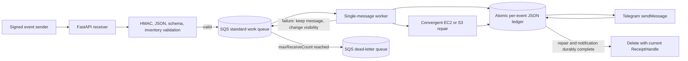

# Fénix: local infrastructure self-repair

Fénix receives authenticated infrastructure events, validates them against a group-owned inventory, repairs one authorized LocalStack resource, records progress, and sends a Telegram notification. It is a course lab, not an exactly-once or production cloud controller.

## Team and course responsibilities

The course approved a two-person team-size exception. It did not waive any role, evidence, review, or defense requirement. Team member names, email addresses, and responsible-person assignments remain pending; the exception did not define how the six roles are allocated.

| Team member | Email | Status |
|---|---|---|
| `[Pending: member 1 name]` | `[Pending: member 1 email]` | Not assigned in this repository |
| `[Pending: member 2 name]` | `[Pending: member 2 email]` | Not assigned in this repository |

| Required course role | Module focus and evidence summary | Responsible person |
|---|---|---|
| I1 Entradas y Excepciones | `receiver.py`, `events.py`, validation, and signature handling; signed-input rejection and HTTP error evidence (F04–F07, F13). | `[Pending assignment]` |
| I2 Mensajería e Inventario Cloud | `sqs.py`, `demo.py`, and settings; queue/DLQ behavior, group-owned inventory, and reconciliation evidence (F01, F08, F10). | `[Pending assignment]` |
| I3 Webhooks y Reparación | Webhook acceptance and verified EC2/S3 remediation in `receiver.py` and `remediation.py` (F02–F07). | `[Pending assignment]` |
| I4 Observabilidad y Comunicación | Telegram delivery/retry evidence and redacted rotating logs in `notifications.py` and `logging_json.py` (F02, F14, F16). | `[Pending assignment]` |
| I5 Integración y Worker | Durable processing, visibility retries, recovery, and acknowledgment in `worker.py`, `state.py`, and `sqs.py` (F08–F12). | `[Pending assignment]` |
| I6 Pruebas y Diagnóstico | Test reports and diagnostic evidence mapped to the verification matrix (F01–F16), distinguishing offline results from pending integrations. | `[Pending assignment]` |

## Prerequisites

- Python 3.12.3 is the selected project team target and is verified in this checkout's `.venv`. The second team member must use Python 3.12.3 too; their environment has not yet been verified. `pyproject.toml` keeps `requires-python = ">=3.11"` because the course permits newer versions and the metadata retains a compatibility floor rather than pinning the team target.
- Docker Desktop with its WSL2 engine, Docker Compose, and the course-approved LocalStack image and authorization configuration.
- A Telegram bot and chat configured by the team outside source control. Never paste credentials into issues, chat, screenshots, or this README.
- The approved course guide and resource naming rules.

`requirements.txt` declares the direct dependencies; `requirements-lock.txt` records the package versions installed in the verified Python 3.12.3 `.venv`, including a portable editable-project entry (`-e .`). The lockfile does not use a machine-specific path. Both team members must use the selected Python version; confirm the second member's interpreter before treating the team environment as aligned. Do not use an unapproved LocalStack image or copy a sample authorization token into a shared artifact. The AWS SDK client rejects endpoints other than loopback port 4566 and always uses dummy local credentials.

## Install from a clean checkout

1. Create and activate a virtual environment:

   ```bash
   python3.12 -m venv .venv
   source .venv/bin/activate
   python --version  # Must report Python 3.12.3
   python -m pip install -r requirements-lock.txt
   ```

2. Create the ignored local environment file and enter only cátedra-approved local settings:

   ```bash
   cp .env.example .env
   ```

   Required or supported variable names are `AWS_ENDPOINT_URL`, `AWS_DEFAULT_REGION`, `GROUP_ID`, `QUEUE_PREFIX`, `WEBHOOK_SECRET`, `NOTIFY_PROVIDER`, `TELEGRAM_BOT_TOKEN`, `TELEGRAM_CHAT_ID`, `LOCALSTACK_IMAGE`, and `LOCALSTACK_AUTH_TOKEN`. `AWS_ACCESS_KEY_ID` and `AWS_SECRET_ACCESS_KEY` are not used by the application client; the application supplies dummy values itself. No values are documented here.

3. After the course-approved image and token have been confirmed, start the local emulator:

   ```bash
   docker compose up -d localstack
   ```

4. Initialize queues and the group's tagged demo resources:

   ```bash
   python -m fenix.cli init-queues
   python -m fenix.cli setup-demo
   ```

5. Start the receiver and worker in separate terminals:

   ```bash
   uvicorn fenix.services.receiver:app --host 127.0.0.1 --port 8000
   python -m fenix.cli worker
   ```

The LocalStack launch and all cloud-facing commands above are instructions for an approved lab session. They were not run during the reported verification.

## Event flow



## Webhook contract

The receiver accepts `POST /webhook` with the exact header shape below. The signature is HMAC-SHA256 over the ASCII timestamp bytes, a period, and the original body bytes. The timestamp must be within 300 seconds. Duplicate or ambiguous signature headers are rejected before JSON parsing.

```text
X-Webhook-Signature: t=<epoch>,v1=<64 hexadecimal characters>
```

The body is limited to 16 KiB and is a closed JSON object with exactly these fields:

```json
{
  "schema_version": 1,
  "event_id": "evt-node-001",
  "event_type": "instance.stopped",
  "resource_id": "node-01",
  "occurred_at": "2026-10-22T18:00:00Z",
  "simulate_failures": 0
}
```

`event_id` and `resource_id` must match `[a-z0-9-]{3,32}`. The only event types are `instance.stopped` for `node-01` and `bucket.tags_missing` for `bucket-01`. `simulate_failures` is an integer from 0 through 5; booleans are invalid. Timestamps must explicitly be UTC (`Z` or `+00:00`). Resource identifiers and cloud destinations cannot be supplied in the request.

| HTTP status | Meaning |
|---|---|
| `202` | SQS confirmed the send; body contains `status`, `event_id`, and `message_id`. |
| `400` | Signed body is not valid UTF-8 or JSON. |
| `401` | Signature missing, malformed, duplicated, invalid, or outside the time window. |
| `413` | Body exceeds 16 KiB. |
| `422` | JSON is valid but violates the event or inventory contract. |
| `503` | Inventory or SQS is unavailable; the receiver does not claim acceptance. |

## Resource inventory

`data/inventory.json` is keyed by the event aliases. Each resource stores its cloud identifier under the single canonical `id` key; webhook events continue to contain only `node-01` or `bucket-01` in `resource_id`.

```json
{
  "node-01": {
    "type": "ec2",
    "group_id": "grupo-01",
    "id": "i-0123456789abcdef0",
    "security_group_id": "sg-0123456789abcdef0",
    "expected_tags": {
      "ManagedBy": "ppa2",
      "Project": "fenix",
      "GroupId": "grupo-01",
      "Owner": "grupo-01",
      "Name": "fenix-grupo-01-node"
    },
    "status": "ready"
  },
  "bucket-01": {
    "type": "s3",
    "group_id": "grupo-01",
    "id": "fenix-grupo-01-demo",
    "expected_tags": {
      "ManagedBy": "ppa2",
      "Project": "fenix",
      "GroupId": "grupo-01",
      "Owner": "grupo-01"
    },
    "status": "ready"
  }
}
```

The setup command may also store metadata such as `group_id`, `status`, and the EC2 `image_id`. The receiver resolves the alias against this inventory and does not accept a cloud identifier in the webhook.

## Observed webhook latency

After SQS confirms publication, the receiver logs `latency_ms`, measured with a monotonic clock from request-handler entry through the confirmed send. This is an observed value, not a hard `<100 ms` success target. Record the real measurement and its evidence during the approved LocalStack run; no LocalStack latency measurement is claimed in this repository.

## CLI and fault scenarios

| Command | Purpose |
|---|---|
| `python -m fenix.cli init-queues` | Ensure the standard work queue and DLQ exist and reconcile their attributes. |
| `python -m fenix.cli setup-demo` | Reconcile the current group's tagged EC2 and S3 resources, record the selected mock image ID, and save `data/inventory.json`. |
| `python -m fenix.cli fault node-01` | Stop only the inventory-owned EC2 instance. |
| `python -m fenix.cli fault bucket-01` | Remove only the inventory-owned bucket's `Owner` tag. |
| `python -m fenix.cli send examples/node-event.json` | Sign the exact file bytes and send the webhook request. |
| `python -m fenix.cli worker --once` | Poll once and process at most one received batch; useful for controlled verification. |
| `python -m fenix.cli worker` | Run the worker until interrupted with Ctrl+C. |

The console notification adapter is development-only. Final course evidence requires the Telegram adapter and a redacted confirmation artifact; no real Telegram request was made for this implementation.

## Retry, DLQ, and idempotency decisions

- Queue type is standard, with a 45-second visibility timeout, 10-second long polling, one message per receive, and `maxReceiveCount=3` on the redrive policy.
- On failure, the worker retains the original message and changes visibility using its current receipt handle. Delays are `min(30, 2 ** ApproximateReceiveCount)`; Telegram `Retry-After` can raise the delay, capped at 30 seconds. The worker never republishes a retry.
- A poison message is not acknowledged. SQS, not an application retry loop, moves it to the DLQ after the configured receives. No exact wall-clock deadline is promised.
- `data/events.json` is atomically replaced and stores the event content, attempt count, repair stage/result, notification state, status, and conflicting content. A repeated `event_id` with different content preserves the first content, records the conflict, performs no repair for the conflicting event, and remains unacknowledged for DLQ handling.
- Completed repair and notification stages are resumed rather than repeated when their state is durable. A crash after a provider accepts a notification but before the ledger records it can still cause a duplicate. JSON, cloud APIs, Telegram, and SQS do not share a transaction; exactly-once processing is not claimed.
- EC2 repair starts only a stopped instance, never reboots it, and verifies `running`. S3 repair merges expected tags, preserves unrelated tags, writes only after ownership checks, and reads the tags back for verification.

## Verification matrix

### Verified snapshot

- Environment: Python 3.12.3 in `.venv`; selected and verified project team target. The second member's environment remains to be confirmed.
- Offline command: `./.venv/bin/python -m pytest -m "not integracion" -q` — **56 passed, 6 `integracion` tests deselected**.
- `git diff --check` passed; `pip check` reported no broken requirements.
- A scan found no Python `TODO` or `NotImplementedError` placeholders.
- No LocalStack, AWS, or real Telegram calls were made.

The 53 passing tests include repository compliance guards, CLI boundary/raw-byte tests, queued-log flush coverage, the parameterized Telegram 5xx `Retry-After` regression test, and a crash-window case where a repair succeeds but saving its ledger checkpoint fails; the retry re-queries the resource and converges without repeating the EC2 start effect. F01, F02, F03, F08, F10, and the LocalStack portion of F13 remain pending course-approved integration. LocalStack scenarios also require the opt-in variables documented below.

`tests/test_compliance.py` checks the assignment's prohibited exception/finally patterns; `tests/test_cli.py` checks early argument rejection, exact signed-file bytes, and listener cleanup; `tests/test_logging.py` verifies queued records flush on listener stop. The opt-in F01 integration test also checks that the work queue targets the configured DLQ, uses `maxReceiveCount=3`, and that the DLQ has no nested redrive policy; that integration test was not run.

| ID | Date | Command / pytest test | Anonymized input | Expected | Observed | Evidence | Responsible |
|---|---|---|---|---|---|---|---|
| F01 | Pending | `test_localstack_integration.py::test_f01_queue_and_demo_setup_are_idempotent` | Unique `it-*` group; run queue/demo setup twice. | One owned resource set; work queue targets the DLQ; `maxReceiveCount=3`; no nested DLQ redrive policy. | Not run; course-approved LocalStack configuration pending. | `[Pending: command output, inventory, and queue attributes]` | `[Pending assignment]` |
| F02 | Pending | `test_localstack_integration.py::test_f02_verified_ec2_repair_durable_ledger_mocked_telegram_and_real_ack` | Synthetic `evt-node-001` for alias `node-01`. | EC2 `running` verified; ledger complete; mocked Telegram success; current SQS receipt acknowledged. | Not run; integration pending. Real Telegram evidence also pending. | `[Pending: ledger, state, ACK and redacted Telegram evidence]` | `[Pending assignment]` |
| F03 | Pending | `test_localstack_integration.py::test_f03_bucket_repair_preserves_unrelated_tags` | Synthetic `bucket-01` with missing `Owner` and an unrelated tag. | Restore required tags and preserve unrelated tags. | Not run; course-approved LocalStack configuration pending. | `[Pending: before/after tag evidence]` | `[Pending assignment]` |
| F04 | 2026-11-19 | `test_fenix.py::test_signature_failures_return_401_without_publishing` | Synthetic body with missing, malformed, stale, or invalid signature. | HTTP 401 and no SQS publish. | PASS in offline suite. | `[Attach sanitized pytest output]` | `[Pending assignment]` |
| F05 | 2026-11-19 | `test_fenix.py::test_signature_authenticates_raw_bytes_and_rejects_ambiguous_headers` | Same JSON value serialized to different raw bytes after signing. | HMAC fails; HTTP 401 and no publish. | PASS in offline suite. | `[Attach sanitized pytest output]` | `[Pending assignment]` |
| F06 | 2026-11-19 | `test_fenix.py::test_signed_invalid_json_is_400_and_signed_list_is_422` | Signed malformed JSON and signed JSON array. | HTTP 400 and 422 respectively; no publish. | PASS in offline suite. | `[Attach sanitized pytest output]` | `[Pending assignment]` |
| F07 | 2026-11-19 | `test_fenix.py::test_bad_alias_and_extra_event_fields_return_422_without_publish` | Synthetic unknown alias and event with an extra key. | HTTP 422; no cloud operation. | PASS in offline suite. | `[Attach sanitized pytest output]` | `[Pending assignment]` |
| F08 | Pending | `test_localstack_integration.py::test_f08_corrupt_direct_sqs_message_reaches_real_dlq_without_stopping_worker` | Corrupt synthetic message published directly to the work queue. | Worker continues; original message reaches the real DLQ. | Not run; course-approved LocalStack configuration pending. | `[Pending: original body and DLQ evidence]` | `[Pending assignment]` |
| F09 | 2026-11-19 | `test_scenarios.py::test_simulated_failures_persist_across_attempts_then_complete` | Synthetic event with `simulate_failures=2`. | Persist attempts; visibility backoff; complete on the third execution. | PASS in offline suite; real SQS timing remains unverified. | `[Attach sanitized pytest output and ledger excerpt]` | `[Pending assignment]` |
| F10 | Pending | `test_localstack_integration.py::test_f10_persistent_handler_failure_reaches_real_dlq_without_ack` | Synthetic event with `simulate_failures=5`. | No repair or ACK; SQS moves the message to the real DLQ. | Not run; course-approved LocalStack configuration pending. | `[Pending: receive count, ledger, and DLQ evidence]` | `[Pending assignment]` |
| F11 | 2026-11-19 | `test_scenarios.py::test_duplicate_after_restart_does_not_repeat_completed_stages` | Repeat a completed synthetic event after reloading its ledger. | No repeated repair or notification. | PASS in offline suite. | `[Attach sanitized pytest output and ledger excerpt]` | `[Pending assignment]` |
| F12 | 2026-11-19 | `test_scenarios.py::test_restart_after_repair_resumes_notification_only`; `test_repair_converges_when_ledger_checkpoint_save_fails` | Synthetic repair followed by notification/checkpoint failure. | Resume notification only; if the repair checkpoint fails, re-query and converge without repeating EC2 start. | PASS in offline suite. | `[Attach sanitized pytest output and ledger excerpt]` | `[Pending assignment]` |
| F13 | 2026-11-19 | `test_fenix.py::test_sqs_failure_returns_503_without_false_acceptance`; LocalStack test remains pending. | Valid synthetic event with a mocked unavailable queue. | HTTP 503; no false acceptance. | Offline mocked test PASS; real LocalStack outage test not run. | `[Attach sanitized pytest output; LocalStack evidence pending]` | `[Pending assignment]` |
| F14 | 2026-11-19 | `test_scenarios.py::test_f14_rate_limit_and_timeout_resume_notification_without_repair_repeat`; `test_telegram_5xx_retry_after_is_propagated_and_bounded` | Mocked Telegram 429, timeout, and 5xx with `Retry-After`. | Retry notification only; bounded wait; do not repeat confirmed repair. | PASS in offline suite; real Telegram evidence pending. | `[Attach sanitized pytest output]` | `[Pending assignment]` |
| F15 | 2026-11-19 | `test_scenarios.py::test_conflicting_event_id_preserves_first_content_and_never_repairs_again` | Same synthetic event ID with different content. | Preserve original ledger; record conflict; do not repair conflicting event. | PASS in offline suite. | `[Attach sanitized pytest output and conflict ledger excerpt]` | `[Pending assignment]` |
| F16 | 2026-11-19 | `test_logging.py::test_small_threshold_rotates_to_readable_gzip_json_without_secrets` | Synthetic JSON log messages with small rotation threshold. | Readable gzip JSONL, UTC context, redacted secrets. | PASS in offline suite. | `[Attach sanitized pytest output and redacted log excerpts]` | `[Pending assignment]` |

To opt in to the integration tests, first obtain the course's approval and prepare the approved local emulator configuration, then set `FENIX_CATEDRA_APPROVED` and `FENIX_RUN_LOCALSTACK` in the test environment. The tests create unique `it-...` group resources and clean up only resources whose ownership tags match that generated group. They do not send real Telegram messages.

## Limitations and cleanup

- The ledger uses atomic file replacement, not a multi-service transaction, process lock, or exactly-once protocol. Run one worker process per project data directory.
- Cloud remediation and queue behavior are constrained to loopback port 4566. No AWS account endpoint or credentials are supported.
- Resource reconciliation depends on LocalStack EC2 mock image/VPC support and the course-approved emulator version. That support has not been exercised in this implementation task.
- Telegram delivery is not transactional with the ledger; an uncertain HTTP result can produce a duplicate notice.
- The application has no resource-destruction CLI. Stop the approved local lab with `docker compose down` after saving required evidence. Do not use cleanup commands against another group's endpoint or inventory.

## Required defense artifacts

- Team member names, emails, responsible-person assignments, and completed role evidence: `[Pending: fill from the approved course guide and attach evidence]`.
- Telegram evidence: `[Pending: attach redacted Bot API success evidence; never include the bot token or private chat credentials]`.
- Video: `[Pending: link]`.
- Video timestamps: `[Pending: timestamp — topic]`.

## AI assistance declaration

AI assistance was used to implement the validation, queue, LocalStack lab, webhook, remediation, Telegram, worker, ledger, and test/documentation changes. The Python 3.12.3 `.venv` offline run passed 56 tests with 6 integration tests deselected, including the inventory-ID contract, observed latency, compliance, CLI, logging lifecycle, 5xx `Retry-After`, and repair-checkpoint crash-window tests; `git diff --check` and `pip check` also passed, and no Python TODO or NotImplementedError placeholders remain. No LocalStack, AWS, or real Telegram calls occurred. Course-approved integration evidence, final evidence artifacts, human review, role assignments, real Telegram confirmation, and video materials remain pending. The team must review and understand all changes before submission.
