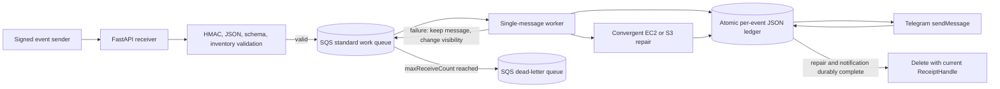

# Fénix: local infrastructure self-repair

Fénix receives authenticated infrastructure events, validates them against a group-owned inventory, repairs one authorized LocalStack resource, records progress, and sends a Telegram notification. It is a course lab, not an exactly-once or production cloud controller.

## Team and course responsibilities

The course approved a two-person team-size exception. It did not waive any role, evidence, review, or defense requirement. Names, email addresses, exact course role titles, and assignments remain pending; copy the official role names from the course guide rather than inventing them here.

| Team member | Email | Status |
|---|---|---|
| `[Pending: member 1 name]` | `[Pending: member 1 email]` | Not assigned in this repository |
| `[Pending: member 2 name]` | `[Pending: member 2 email]` | Not assigned in this repository |

| Required course role | Responsible person | Required role evidence / defense artifact |
|---|---|---|
| `[Pending: official role 1 title]` | `[Pending assignment]` | `[Pending: evidence and defense reference]` |
| `[Pending: official role 2 title]` | `[Pending assignment]` | `[Pending: evidence and defense reference]` |
| `[Pending: official role 3 title]` | `[Pending assignment]` | `[Pending: evidence and defense reference]` |
| `[Pending: official role 4 title]` | `[Pending assignment]` | `[Pending: evidence and defense reference]` |
| `[Pending: official role 5 title]` | `[Pending assignment]` | `[Pending: evidence and defense reference]` |
| `[Pending: official role 6 title]` | `[Pending assignment]` | `[Pending: evidence and defense reference]` |

## Prerequisites

- Python 3.11 or newer (`pyproject.toml` declares `requires-python = ">=3.11"`).
- Docker Desktop with its WSL2 engine, Docker Compose, and the course-approved LocalStack image and authorization configuration.
- A Telegram bot and chat configured by the team outside source control. Never paste credentials into issues, chat, screenshots, or this README.
- The approved course guide and resource naming rules.

The repository does not pin dependency versions. `requirements-lock.txt` remains pending until both team members agree on one Python version. The verification environment used Python 3.12.3 in `.venv`. Do not use an unapproved LocalStack image or copy a sample authorization token into a shared artifact. The AWS SDK client rejects endpoints other than loopback port 4566 and always uses dummy local credentials.

## Install from a clean checkout

1. Create and activate a virtual environment:

   ```bash
   python3 -m venv .venv
   source .venv/bin/activate
   python -m pip install --upgrade pip
   python -m pip install -e .
   ```

2. Create the ignored local environment file and enter only cátedra-approved local settings:

   ```bash
   cp .env.example .env
   ```

   Required or supported variable names are `AWS_ENDPOINT_URL`, `AWS_DEFAULT_REGION`, `GROUP_ID`, `QUEUE_PREFIX`, `WEBHOOK_SECRET`, `NOTIFY_PROVIDER`, `TELEGRAM_BOT_TOKEN`, `TELEGRAM_CHAT_ID`, `LOCALSTACK_IMAGE`, and `LOCALSTACK_AUTH_TOKEN`. `AWS_ACCESS_KEY_ID` and `AWS_SECRET_ACCESS_KEY` are not used by the application client; the application supplies dummy values itself. No values are documented here.

3. After the course-approved image and token have been confirmed, start the local emulator:

   ```bash
   docker compose up -d localstack
   ```

4. Initialize queues and the group's tagged demo resources:

   ```bash
   python -m fenix.cli init-queues
   python -m fenix.cli setup-demo
   ```

5. Start the receiver and worker in separate terminals:

   ```bash
   uvicorn fenix.services.receiver:app --host 127.0.0.1 --port 8000
   python -m fenix.cli worker
   ```

The LocalStack launch and all cloud-facing commands above are instructions for an approved lab session. They were not run during the reported verification.

## Event flow



## Webhook contract

The receiver accepts `POST /webhook` with the exact header shape below. The signature is HMAC-SHA256 over the ASCII timestamp bytes, a period, and the original body bytes. The timestamp must be within 300 seconds. Duplicate or ambiguous signature headers are rejected before JSON parsing.

```text
X-Webhook-Signature: t=<epoch>,v1=<64 hexadecimal characters>
```

The body is limited to 16 KiB and is a closed JSON object with exactly these fields:

```json
{
  "schema_version": 1,
  "event_id": "evt-node-001",
  "event_type": "instance.stopped",
  "resource_id": "node-01",
  "occurred_at": "2026-10-22T18:00:00Z",
  "simulate_failures": 0
}
```

`event_id` and `resource_id` must match `[a-z0-9-]{3,32}`. The only event types are `instance.stopped` for `node-01` and `bucket.tags_missing` for `bucket-01`. `simulate_failures` is an integer from 0 through 5; booleans are invalid. Timestamps must explicitly be UTC (`Z` or `+00:00`). Resource identifiers and cloud destinations cannot be supplied in the request.

| HTTP status | Meaning |
|---|---|
| `202` | SQS confirmed the send; body contains `status`, `event_id`, and `message_id`. |
| `400` | Signed body is not valid UTF-8 or JSON. |
| `401` | Signature missing, malformed, duplicated, invalid, or outside the time window. |
| `413` | Body exceeds 16 KiB. |
| `422` | JSON is valid but violates the event or inventory contract. |
| `503` | Inventory or SQS is unavailable; the receiver does not claim acceptance. |

## CLI and fault scenarios

| Command | Purpose |
|---|---|
| `python -m fenix.cli init-queues` | Ensure the standard work queue and DLQ exist and reconcile their attributes. |
| `python -m fenix.cli setup-demo` | Reconcile the current group's tagged EC2 and S3 resources, record the selected mock image ID, and save `data/inventory.json`. |
| `python -m fenix.cli fault node-01` | Stop only the inventory-owned EC2 instance. |
| `python -m fenix.cli fault bucket-01` | Remove only the inventory-owned bucket's `Owner` tag. |
| `python -m fenix.cli send examples/node-event.json` | Sign the exact file bytes and send the webhook request. |
| `python -m fenix.cli worker --once` | Poll once and process at most one received batch; useful for controlled verification. |
| `python -m fenix.cli worker` | Run the worker until interrupted with Ctrl+C. |

The console notification adapter is development-only. Final course evidence requires the Telegram adapter and a redacted confirmation artifact; no real Telegram request was made for this implementation.

## Retry, DLQ, and idempotency decisions

- Queue type is standard, with a 45-second visibility timeout, 10-second long polling, one message per receive, and `maxReceiveCount=3` on the redrive policy.
- On failure, the worker retains the original message and changes visibility using its current receipt handle. Delays are `min(30, 2 ** ApproximateReceiveCount)`; Telegram `Retry-After` can raise the delay, capped at 30 seconds. The worker never republishes a retry.
- A poison message is not acknowledged. SQS, not an application retry loop, moves it to the DLQ after the configured receives. No exact wall-clock deadline is promised.
- `data/events.json` is atomically replaced and stores the event content, attempt count, repair stage/result, notification state, status, and conflicting content. A repeated `event_id` with different content preserves the first content, records the conflict, performs no repair for the conflicting event, and remains unacknowledged for DLQ handling.
- Completed repair and notification stages are resumed rather than repeated when their state is durable. A crash after a provider accepts a notification but before the ledger records it can still cause a duplicate. JSON, cloud APIs, Telegram, and SQS do not share a transaction; exactly-once processing is not claimed.
- EC2 repair starts only a stopped instance, never reboots it, and verifies `running`. S3 repair merges expected tags, preserves unrelated tags, writes only after ownership checks, and reads the tags back for verification.

## Verification matrix

### Verified snapshot

- Environment: Python 3.12.3 in `.venv`.
- Offline command: `./.venv/bin/python -m pytest -m "not integracion" -q` — **43 passed, 6 `integracion` tests deselected**.
- `git diff --check` passed; `pip check` reported no broken requirements.
- A scan found no Python `TODO` or `NotImplementedError` placeholders.
- No LocalStack, AWS, or real Telegram calls were made.

The 43 passing tests include the parameterized Telegram 5xx `Retry-After` regression test. F01, F02, F03, F08, F10, and the LocalStack portion of F13 remain pending course-approved integration. LocalStack scenarios also require the opt-in variables documented below.

| ID | Expected behavior | Observed status | Evidence | Responsible |
|---|---|---|---|---|
| F01 | Repeated queue and demo setup reuses exactly one group-owned set of resources. | Integration evidence pending; not run. | `[Pending: command output and resource evidence]` | `[Pending assignment]` |
| F02 | Verified EC2 start, durable ledger, Telegram adapter success, and SQS ACK. | Integration evidence pending; not run. Adapter transport is mocked in the integration test; real Telegram evidence remains pending. | `[Pending: redacted Telegram confirmation and ACK evidence]` | `[Pending assignment]` |
| F03 | Restore the missing `Owner` tag and preserve unrelated bucket tags. | Integration evidence pending; not run. | `[Pending: before/after tag evidence]` | `[Pending assignment]` |
| F04 | Missing, malformed, stale, or invalid signatures return 401 and do not publish. | Offline coverage passed in the 43-test run (`test_signature_failures_return_401_without_publishing`). | `[Pending: attach test report]` | `[Pending assignment]` |
| F05 | The same JSON reserialized to different bytes after signing returns 401 and is not published; the signature covers the raw body bytes. | Offline coverage passed (`test_signature_authenticates_raw_bytes_and_rejects_ambiguous_headers`). | `[Pending: attach test report]` | `[Pending assignment]` |
| F06 | Signed malformed JSON returns 400; signed non-object JSON returns 422. | Offline coverage passed (`test_signed_invalid_json_is_400_and_signed_list_is_422`). | `[Pending: attach test report]` | `[Pending assignment]` |
| F07 | Invalid alias or extra fields are rejected without a cloud change. | Offline receiver coverage passed (`test_bad_alias_and_extra_event_fields_return_422_without_publish`). | `[Pending: attach test report and resource-state evidence]` | `[Pending assignment]` |
| F08 | Corrupt direct-to-SQS message does not stop the worker and reaches the real DLQ. | Pending course-approved LocalStack integration; not run. | `[Pending: original body and DLQ evidence]` | `[Pending assignment]` |
| F09 | Two persisted simulated failures use backoff; the next event execution can complete. | Offline coverage passed (`test_simulated_failures_persist_across_attempts_then_complete`, `test_retry_later_changes_visibility_on_current_receipt`). | `[Pending: attach test report and ledger excerpt]` | `[Pending assignment]` |
| F10 | `simulate_failures=5` reaches the real DLQ without repair or ACK. | Pending course-approved LocalStack integration; not run. | `[Pending: receive count, ledger, and DLQ evidence]` | `[Pending assignment]` |
| F11 | Duplicate delivery or worker restart does not repeat durably completed repair/notification stages. | Offline coverage passed (`test_duplicate_after_restart_does_not_repeat_completed_stages`). | `[Pending: attach test report and ledger excerpt]` | `[Pending assignment]` |
| F12 | Restart after repair but before notification resumes notification only. | Offline coverage passed (`test_restart_after_repair_resumes_notification_only`). | `[Pending: attach test report and ledger excerpt]` | `[Pending assignment]` |
| F13 | SQS unavailable returns 503 and never reports false acceptance. | Offline mocked 503 coverage passed (`test_sqs_failure_returns_503_without_false_acceptance`); LocalStack integration remains pending course approval. | `[Pending: attach test report and LocalStack HTTP evidence]` | `[Pending assignment]` |
| F14 | Mocked Telegram 429/timeout and 5xx Retry-After are retried without repeating confirmed repair. | Offline coverage passed, including `test_f14_rate_limit_and_timeout_resume_notification_without_repair_repeat` and `test_telegram_5xx_retry_after_is_propagated_and_bounded`. | `[Pending: attach test report]` | `[Pending assignment]` |
| F15 | Conflicting content for one event ID preserves the first ledger entry and does not repair again. | Offline coverage passed (`test_conflicting_event_id_preserves_first_content_and_never_repairs_again`). | `[Pending: attach test report and conflict ledger excerpt]` | `[Pending assignment]` |
| F16 | Small-threshold rotation produces readable gzip JSON UTC records without logged secrets. | Offline coverage passed (`test_small_threshold_rotates_to_readable_gzip_json_without_secrets`). | `[Pending: attach test report and redacted log excerpts]` | `[Pending assignment]` |

To opt in to the integration tests, first obtain the course's approval and prepare the approved local emulator configuration, then set `FENIX_CATEDRA_APPROVED` and `FENIX_RUN_LOCALSTACK` in the test environment. The tests create unique `it-...` group resources and clean up only resources whose ownership tags match that generated group. They do not send real Telegram messages.

## Limitations and cleanup

- The ledger uses atomic file replacement, not a multi-service transaction, process lock, or exactly-once protocol. Run one worker process per project data directory.
- Cloud remediation and queue behavior are constrained to loopback port 4566. No AWS account endpoint or credentials are supported.
- Resource reconciliation depends on LocalStack EC2 mock image/VPC support and the course-approved emulator version. That support has not been exercised in this implementation task.
- Telegram delivery is not transactional with the ledger; an uncertain HTTP result can produce a duplicate notice.
- The application has no resource-destruction CLI. Stop the approved local lab with `docker compose down` after saving required evidence. Do not use cleanup commands against another group's endpoint or inventory.

## Required defense artifacts

- Team roles, names, emails, and per-role evidence: `[Pending: fill from the approved course guide]`.
- Telegram evidence: `[Pending: attach redacted Bot API success evidence; never include the bot token or private chat credentials]`.
- Video: `[Pending: link]`.
- Video timestamps: `[Pending: timestamp — topic]`.

## AI assistance declaration

AI assistance was used to implement the validation, queue, LocalStack lab, webhook, remediation, Telegram, worker, ledger, offline/integration test scaffolding, and README changes. The Python 3.12.3 `.venv` offline run passed 43 tests with 6 integration tests deselected, including the 5xx `Retry-After` regression test; `git diff --check` and `pip check` also passed, and no Python TODO or NotImplementedError placeholders remain. No LocalStack, AWS, or real Telegram calls occurred. Course-approved integration evidence, final evidence artifacts, human review, role assignments, real Telegram confirmation, and video materials remain pending. The team must review and understand all changes before submission.
