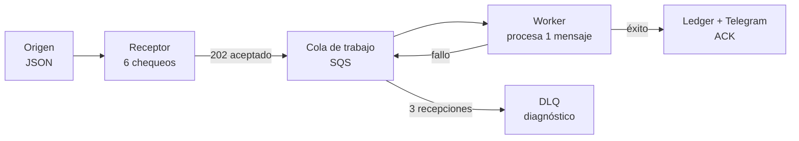
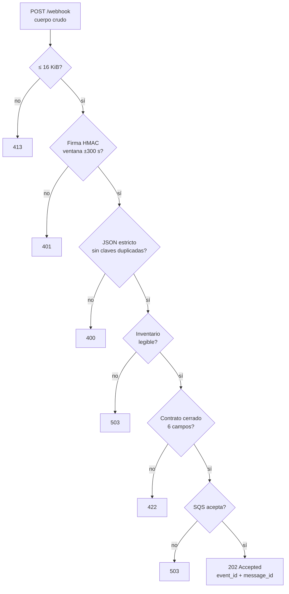
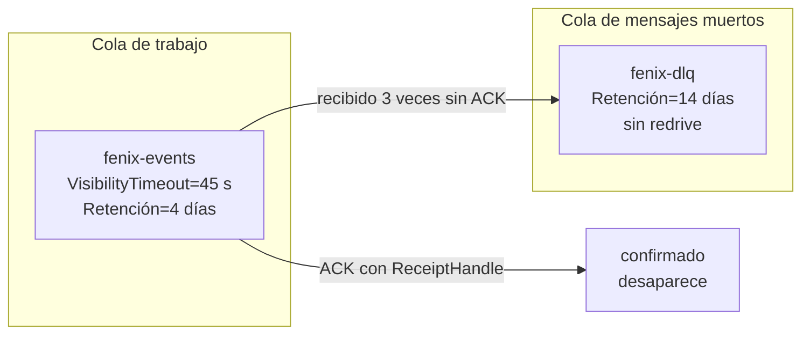
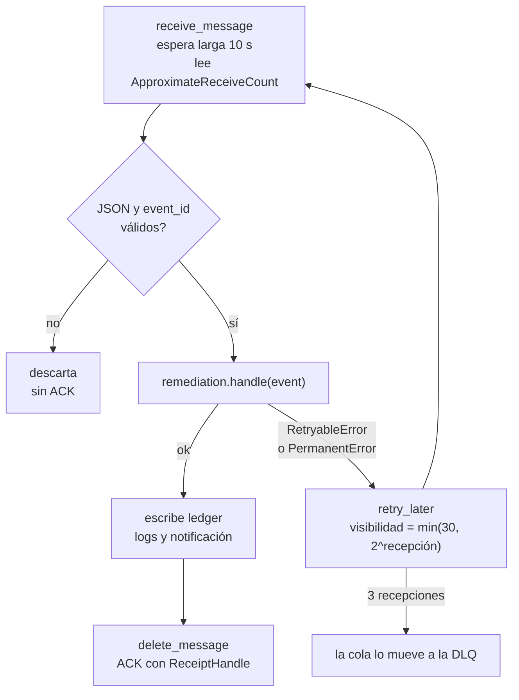
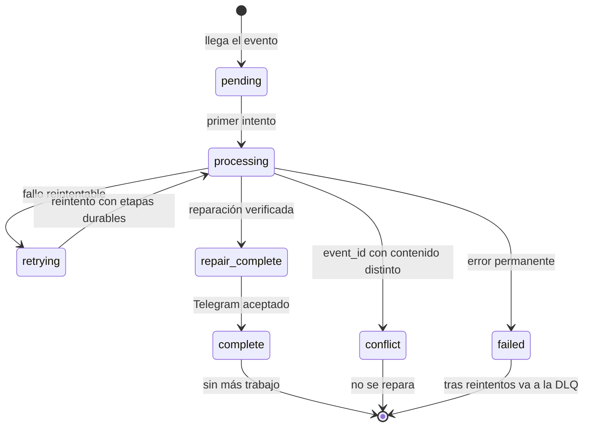

# Guion narrado: cómo viaja el dato en Fénix

Guion de voz en off para el video de defensa. Cada bloque trae:

- **NARRACIÓN**: texto exacto que se lee en voz alta.
- **EN PANTALLA**: qué se muestra sincronizado con esa parte.
- **DIAGRAMA**: imagen Mermaid que GitHub renderiza (también sirve de plantilla para captura de pantalla).

Los diagramas usan sintaxis validada por GitHub (`flowchart` y `stateDiagram-v2`). Las etiquetas con paréntesis van entre comillas.

---

## Bloque 0 — Preparación (antes de grabar)

**EN PANTALLA**: terminal vacía, tres paneles (tmux o tres ventanas).

```bash
# Terminal 1 — LocalStack
docker compose up -d
curl -s http://localhost:4566/_localstack/health | head -5

# Terminal 1 — receptor (desde la raíz del repo; load_dotenv() lee .env solo)
source .venv/bin/activate
uvicorn fenix.services.receiver:app --host 127.0.0.1 --port 8000

# Terminal 2 — worker (load_dotenv() también corre solo; nunca exportar .env en pantalla)
source .venv/bin/activate
python -m fenix.cli worker

# Terminal 3 — operador
source .venv/bin/activate
python -m fenix.cli init-queues
python -m fenix.cli setup-demo
```

No se muestra en pantalla: `.env` (credenciales), `logs/` sin leerse completo.

---

## Bloque 1 — El problema (1 frase + analogía)

**NARRACIÓN:**

> Este es Fénix: un laboratorio que repara infraestructura solo. Cuando una instancia EC2 se apaga o a un bucket S3 le faltan etiquetas, alguien tiene que enterarse y actuar. Fénix lo hace con un principio corto: **primero verificar, después actuar, y cada paso deja un rastro.**
>
> La analogía es una oficina de correos con una lista de chequeo. Un paquete llega, se revisa la dirección, se firma el recibo, y recién ahí entra a la sala de procesamiento. Si el paquete está mal, no se pierde: queda en una estantería de problemas donde alguien puede mirarlo después.

**EN PANTALLA**: título del proyecto + las tres palabras del principio.

---

## Bloque 2 — El mapa completo del dato

**NARRACIÓN:**

> Un dato recorre siete estaciones. Nace como un JSON en el webhook. El receptor lo valida y lo publica en una cola. El worker lo saca de la cola, lo procesa y lo repara. Si todo sale bien, se confirma y desaparece. Si falla, vuelve a la cola con una espera. Si falla tres veces, termina en la cola de mensajes muertos, donde se puede diagnosticar sin que se pierda.

**DIAGRAMA — flujo general con la ruta de fallo:**



**EN PANTALLA**: `docs/assets/flujo.svg` (diagrama ya publicado en Pages) o captura de este bloque.

---

## Bloque 3 — El receptor: seis puertas antes de tocar la cola

**NARRACIÓN:**

> El receptor es una puerta estrecha. Un evento entra por `POST /webhook` y pasa por seis chequeos **en un orden fijo**. El orden importa: cada puerta es más barata que la anterior, así rechazamos rápido lo barato de rechazar.
>
> **Primero el tamaño.** Cuerpos de más de 16 KiB reciben `413`. Esto sale antes que cualquier otra cosa porque leer y firmar un cuerpo enorme es trabajo gratis que no vamos a hacer.
>
> **Segundo, la firma.** El cliente calcula HMAC-SHA256 sobre `timestamp.punto.cuerpo` y lo manda en `X-Webhook-Signature: t=...,v1=...`. Verificamos la sintaxis exacta del encabezado, que la marca de tiempo esté dentro de ±300 segundos, y comparamos con comparación de tiempo constante. Un byte distinto en el cuerpo rompe la firma. Cualquier problema es `401`.
>
> **Tercero, el JSON.** Tiene que parsear estricto: claves duplicadas y `NaN`/`Infinity` no pasan. Mal JSON es `400`.
>
> **Cuarto, el inventario.** Cargamos `data/inventory.json`. Si no existe o no se puede leer, es `503`: no tenemos con qué validar.
>
> **Quinto, el contrato.** El esquema está cerrado: solo seis campos, `schema_version` exactamente 1, tipo de recurso con alias conocidos, identificador con regex, `simulate_failures` entre 0 y 5, y las etiquetas de propiedad que tiene que traer. Cualquier cosa fuera de contrato es `422`.
>
> **Sexto, la cola.** Recién ahí publicamos en SQS. Si la cola no responde, `503`. Y solo cuando SQS confirma, respondemos `202 Accepted` con `event_id` y `message_id`.
>
> Nota clave: **`202` no significa "procesado", significa "aceptado para procesar"**. El trabajo recién empieza.

**DIAGRAMA — las seis puertas en orden:**



**Tabla de referencia (para el narrador, no se lee en voz alta):**

| # | Chequeo | Código | Archivo |
|---|---------|--------|---------|
| 1 | Tamaño ≤ 16 KiB | 413 | `src/fenix/services/receiver.py:63` |
| 2 | HMAC + ventana ±300 s | 401 | `receiver.py:67-71`, `src/fenix/utils/crypto.py:28` |
| 3 | JSON estricto | 400 | `receiver.py:80` |
| 4 | Inventario disponible | 503 | `receiver.py:85-87` |
| 5 | Contrato de evento | 422 | `receiver.py:91`, `src/fenix/services/events.py` |
| 6 | Publicación a SQS | 503 / 202 | `receiver.py:96`, `receiver.py:57` |

**EN PANTALLA**: la tabla anterior, o el flujo anterior con cada puerta resaltada al mencionarla.

---

## Bloque 4 — La cola: por qué no se pierde nada

**NARRACIÓN:**

> La cola tiene dos caras. La **cola de trabajo** recibe los eventos validados. La **cola de mensajes muertos**, o DLQ, recibe lo que falló tres veces. Están conectadas por una regla: si un mensaje se recibe tres veces sin confirmarse, SQS lo mueve solo a la DLQ.
>
> Tres números importantes. `VisibilityTimeout` es **45 segundos**: cuando el worker toma un mensaje, la cola lo esconde ese tiempo para que nadie más lo tome. Si el worker no confirma en ese plazo, el mensaje reaparece solo. `MessageRetentionPeriod` es 4 días en la cola de trabajo y **14 días en la DLQ**, porque los mensajes muertos se guardan para diagnosticarlos, no para borrarlos. Y `maxReceiveCount` es **3**.
>
> Un detalle que casi nadie menciona: es una cola **estándar**, no FIFO. No hay orden garantizado y puede haber entregas duplicadas. Eso no es un descuido: la deduplicación la resolvemos después, en el worker, con un ledger por `event_id`.

**DIAGRAMA — colas y regla de redrive:**



**EN PANTALLA**: captura de `python -m fenix.cli init-queues` mostrando las dos colas, o `scripts/check_dlq.py` con el verdicto de `maxReceiveCount is 3`.

---

## Bloque 5 — El worker: un mensaje a la vez

**NARRACIÓN:**

> El worker hace una sola cosa en bucle: saca **un** mensaje, lo procesa, y decide si lo confirma o si lo devuelve. Nunca procesa dos a la vez, y nunca re-publica un mensaje que falló: eso sería duplicar trabajo.
>
> El ciclo completo:
>
> **1. Recibe.** Llamada `receive_message` con espera larga de 10 segundos y `ApproximateReceiveCount` como atributo. Ese número es cuántas veces SQS ya entregó este mensaje: la primera entrega es 1, y de ahí sale el cálculo de espera.
>
> **2. Valida.** Si el cuerpo no es JSON o no tiene `event_id`, se descarta sin más.
>
> **3. Procesa.** Llama a `remediation.handle(event)`.
>
> **4. Decide.** Si terminó bien, escribe el ledger y **recién ahí** confirma con `delete_message` usando el `ReceiptHandle` que le entregó SQS. Si algo falla, no confirma: cambia la visibilidad con `retry_later`, que la fija en `min(30, 2^recepción)` segundos.
>
> Aquí está la parte que hay que repetir despacio: **el worker no borra nada si falla.** El mensaje sigue en la cola. Con espera de 2 segundos en el primer reintento, 4 en el segundo, 8 en el tercero. Si el mensaje llega a una cuarta entrega, el worker ya no lo ve: la regla de la cola lo mandó a la DLQ.
>
> Y ojo con una sutileza: **un error permanente también pasa por esa misma cola de reintentos**. El worker no distingue "esto nunca va a funcionar" de "esto falló por ahora": en ambos casos devuelve el mensaje y espera. La DLQ es la que decide cuándo se rinde.

**DIAGRAMA — ciclo de vida de un mensaje en el worker:**



**Tabla de reintentos (no se lee, se muestra):**

| Entrega | Espera antes de volver a aparecer | ¿Quién la calcula? |
|---------|-----------------------------------|--------------------|
| 1.ª falla | 2 s (`2^1`) | `retry_later` en `src/fenix/services/sqs.py:97` |
| 2.ª falla | 4 s (`2^2`) | ídem |
| 3.ª falla | 8 s (`2^3`) | ídem, cap 30 s |
| 4.ª entrega | — | el worker ya no la ve; va a la DLQ (`maxReceiveCount=3`) |

**EN PANTALLA**: el diagrama anterior; después, los logs en `logs/fenix-worker-*.jsonl` (la terminal del worker no imprime nada).

---

## Bloque 6 — Qué hace realmente el worker dentro de `handle`

**NARRACIÓN:**

> El worker decide confirmar o no. Pero *qué* hace con el mensaje está en `remediation.handle`. Ahí hay cuatro etapas durables.
>
> **Primero, el ledger.** Es un archivo `data/events.json` con un registro por `event_id`. Si este evento ya terminó, se sale enseguida: procesar dos veces el mismo evento es gratis. Si el mismo `event_id` llegó con contenido distinto, eso es un conflicto real: se marca `conflicts` y no se repara nada.
>
> **Segundo, el fallo simulado.** Para la demo, el campo `simulate_failures` hace fallar los primeros N intentos. Así puedo mostrar el ciclo de reintentos sin romper nada real.
>
> **Tercero, la reparación**, que depende del tipo:
>
> - **EC2**: si la instancia está `running`, ya está bien. Si está `stopped`, la arranco y vuelvo a consultar hasta confirmar `running`. Si está `pending`, es un reintento: todavía no terminó de arrancar. Cualquier otro estado es un error permanente.
> - **S3**: leo las etiquetas actuales del bucket, verifico la propiedad con las etiquetas esperadas, fusiono las etiquetas que faltan y las escribo. Después vuelvo a leer para confirmar que convergieron. Si el inventario dice una cosa y el bucket otra, es un error permanente: no piso sin confirmar.
>
> Cada etapa se guarda en el ledger (`repair_done`, `notified`, `status`). Si el worker muere a mitad de camino, el reintento continúa desde donde estaba, no empieza de cero.
>
> **Cuarto, la notificación.** Recién cuando la reparación está verificada, se manda el mensaje a Telegram con el `event_id`, el recurso y el resultado. Si Telegram falla con 429 o 5xx, se reintenta respetando `Retry-After`, y la etapa `notified` se guarda después: por eso un fallo en ese punto puede duplicar el aviso, y lo decimos en los límites.

**DIAGRAMA — estados de un evento en el ledger:**



**EN PANTALLA**: el diagrama de estados; después, una mirada de `data/events.json` mostrando `attempts`, `repair_done`, `notified` y `status`.

---

## Bloque 7 — Demo en vivo (happy path + fallos)

**NARRACIÓN (happy path):**

> Ahora el camino completo. Inyecto la falla real con `fault node-01` y la instancia queda detenida. Verifico con el script de inspección que quedó `stopped`. Mando el evento firmado. El receptor responde 202. El worker lo toma, arranca la instancia, confirma que quedó `running`, guarda el ledger, manda el aviso y confirma el mensaje. La cola queda vacía.

**Comandos (terminal 3):**

```bash
python -m fenix.cli fault node-01
python scripts/inspect_resources.py                # state=stopped
# event_id fresco: si reusás evt-node-001 el ledger lo toma como ya completo
sed 's/"evt-node-001"/"evt-node-live-001"/' examples/node-event.json > /tmp/live.json
python -m fenix.cli send /tmp/live.json
# → 202 {"status": "accepted", "event_id": "...", "message_id": "..."}
tail -f logs/fenix-worker-*.jsonl    # message_acknowledged
python scripts/inspect_resources.py                # state=running
```

**NARRACIÓN (firma inválida):**

> Ahora rompo la firma a propósito. Mismo cuerpo, timestamp viejo. El receptor ni mira el JSON: falla en la segunda puerta y responde 401. Nada entró a la cola.

```bash
curl -s -o /dev/null -w "%{http_code}\n" -X POST http://127.0.0.1:8000/webhook \
  -H "Content-Type: application/json" \
  -H "X-Webhook-Signature: t=1700000000,v1=$(printf '0%.0s' $(seq 1 64))" \
  --data @examples/node-event.json
# → 401
```

**NARRACIÓN (cuerpo gigante):**

> Ahora un cuerpo enorme. Se corta en la primera puerta: 413, antes de gastar un solo ciclo de HMAC.

```bash
head -c 20000 /dev/zero | tr '\0' 'x' | \
  curl -s -o /dev/null -w "%{http_code}\n" -X POST http://127.0.0.1:8000/webhook \
  -H "Content-Type: application/json" -H "X-Webhook-Signature: t=1,v1=x" --data-binary @-
# → 413
```

**NARRACIÓN (reintentos hasta el éxito):**

> Este evento tiene `simulate_failures: 2`. El worker falla, devuelve el mensaje y espera 2 segundos. Falla otra vez, espera 4. Al tercer intento pasa. En los logs se ven `message_retained_for_2_seconds`, después `message_retained_for_4_seconds`, y al final `message_acknowledged`. El ledger queda en `attempts: 3`.

```bash
# Ojo: cada demo necesita un event_id distinto, si no el ledger lo toma como ya procesado
sed 's/"evt-node-001"/"evt-node-retry-001"/; s/"simulate_failures": 0/"simulate_failures": 2/' \
  examples/node-event.json > /tmp/retry.json
python -m fenix.cli send /tmp/retry.json
tail -f logs/fenix-worker-*.jsonl   # message_retained_for_*_seconds → message_acknowledged
```

**NARRACIÓN (hasta la DLQ):**

> Este tiene `simulate_failures: 5`, más de los tres intentos que permite la cola. Veis los reintentos de 2, 4 y 8 segundos. A la cuarta entrega el worker ya no lo recibe: la regla de redrive lo mandó a la DLQ. Y ahí sigue, conservado 14 días, sin haberse borrado nada.

```bash
sed 's/"evt-node-001"/"evt-node-dlq-001"/; s/"simulate_failures": 0/"simulate_failures": 5/' \
  examples/node-event.json > /tmp/dlq.json
python -m fenix.cli send /tmp/dlq.json
# esperar ~15 s (2 + 4 + 8) mientras el worker reintenta
python scripts/check_dlq.py --peek
# DLQ peek (VisibilityTimeout=0; message not deleted):
#   ApproximateReceiveCount: 3
```

**EN PANTALLA**: tres terminales; al final, el `check_dlq.py --peek` con `ApproximateReceiveCount: 3`.

---

## Bloque 8 — Límites honestos

**NARRACIÓN:**

> Lo que este sistema **no** es, también es parte de la explicación.
>
> - **No es AWS real.** Todo corre sobre LocalStack. La lógica es la misma, el servicio no.
> - **La cola es at-least-once, no exactly-once.** El mensaje puede entregarse más de una vez y sin orden. La defensa es el ledger por `event_id`, no la cola.
> - **Telegram y el ledger no son una transacción.** Si el aviso se manda y el proceso muere antes de guardar `notified`, el reintento puede mandar otro aviso. Lo sabemos y está en el diseño.
> - **Los logs no van a la terminal.** Van a `logs/*.jsonl` rotados. En el video se miran con `tail -f`.
> - **El `202` no certifica reparación.** Certifica que el evento entró.

---

## Bloque 9 — Cierre

**NARRACIÓN:**

> El recorrido completo: un JSON entra por seis puertas, sale con un 202, espera en una cola, lo toma un worker que hace una cosa a la vez, repara, verifica, avisa y recién entonces confirma. Si algo falla, el mensaje no se pierde: espera, reintenta y a la tercera cae en una bandeja donde se puede mirar.
>
> Primero verificar, después actuar, y cada paso deja un rastro. Eso es Fénix.

**EN PANTALLA**: el flujo completo del bloque 2 + la URL del sitio publicado.

---

## Duración estimada

| Bloque | Tiempo aprox. |
|--------|---------------|
| 0–2 (preparación, problema, mapa) | 1:00 |
| 3 (receptor, 6 puertas) | 1:30 |
| 4–5 (cola y worker) | 1:30 |
| 6 (reparación y ledger) | 1:30 |
| 7 (demo en vivo) | 2:30 |
| 8–9 (límites y cierre) | 1:00 |
| **Total** | **~9 min** |
